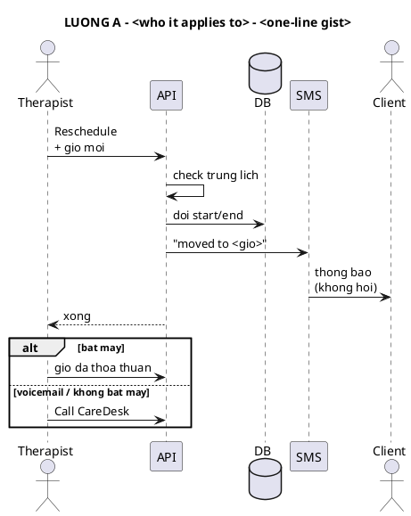

# UML in the terminal

Render PlantUML **sequence diagrams** to unicode text and paste them into the reply. Nothing
else: no HTML page, no Artifact, no PNG. The user reads the diagram inline.

## Steps

1. **Know the flow before drawing.** Read the code / docs first. Every arrow in the diagram is
   a claim about the system; draw only what you verified (keep file:line in your notes, not
   in the diagram).
2. **One diagram per branch.** A flow with a big `alt` tree becomes several small diagrams
   ("A", "B1", "B2"), each ≤ ~40 lines, so each fits one terminal screen. Give each a
   `title` that says who/when it applies (e.g. `LUONG B2 - pilot, ca con <= 12h`).
3. **Write the `.puml` in the session scratchpad** (never in the repo unless asked). Use the
   template below.
4. **Render + check width:**
   ```bash
   bash <this skill dir>/scripts/render.sh <file.puml> [more.puml ...]
   ```
   It runs `plantuml -tutxt`, strips trailing spaces, prints `lines= width=` and the text.
   Target width ≤ 100 columns. Wider → shorten labels, drop a participant, or split.
5. **Paste each `.utxt` into the reply inside a fenced code block** (plain ``` fence, no
   language tag). One sentence above each diagram saying what it shows, a short wrap-up after
   the last one. The diagram is the explanation; keep the prose minimal.

## Template



## Rules that keep it readable (learned the hard way, 2026-10-22)

- **≤ 6 participants**, one-word aliases (`T`, `API`, `DB`, `SMS`, `C`, `CD`). Width is the
  sum of the longest label between each pair of neighbours, so every extra participant and
  every long label pushes the whole thing right.
- **Message labels ≤ 20 chars per line.** `\n` inside a *message* label is fine and is the
  main way to keep width down.
- **No `\n` inside an `alt` / `else` condition** — it prints literally as `\n`.
- **No `note` inside an `alt` / `else`** — the text renderer throws
  `UnsupportedOperationException: NoteTile`. Turn the note into a self-message
  (`API -> API : cron 10 phut: het han`).
- **Only sequence diagrams render to text.** Activity / state / class diagrams need
  `-tpng`/`-tsvg`; `-tutxt` on them produces nothing useful.
- **Measure width in characters, not bytes.** `render.sh` does it in Python. `wc -L` and
  `awk length` on macOS both count bytes, and box-drawing glyphs are 3 bytes each, so they
  report ~1.7× the real width.
- `-tutxt` (unicode: `┌─┐ ╔═╗ ─>`) looks far better than `-ttxt` (`+--+ -->`); use `-ttxt`
  only if the user's terminal cannot show unicode.
- Vietnamese without diacritics inside the diagram (`gio moi`, `bat may`) renders more
  predictably than with; keep diacritics for the prose around it.
- Numbers that matter ("103/190 cases land here") go in the title or the prose, not in a
  floating note.

## Install (once per machine)

```bash
brew install plantuml      # pulls OpenJDK
plantuml -version
```
If `plantuml` is missing, install it before drawing; do not fall back to hand-drawn ASCII,
it never lines up.
